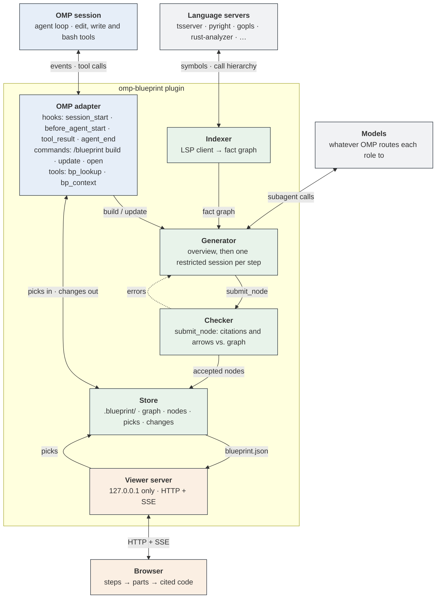

# omp-blueprint

**An Oh My Pi plugin that turns a repository into a drill-down blueprint**

Design spec · Draft 2 · Aryan Ashta · November 10, 2026

> **Summary.** `omp-blueprint` builds a checked, hierarchical map of a codebase: the ordered steps the program takes, each opening onto a diagram of its parts, down to cited line ranges. It runs inside Oh My Pi (OMP), uses language servers for the underlying facts, uses OMP's own model routing for writing, and shows the result in a local browser viewer. The viewer and the agent share context both ways: you send a part to the agent with one click, and parts the agent edits are highlighted. It is a clean-room reimplementation of the idea behind Blueprint (blpr.dev), not a port of its code.

## Contents

1. [Goals and non-goals](#1-goals-and-non-goals)
2. [Concepts](#2-concepts)
3. [Architecture](#3-architecture)
4. [Data model](#4-data-model)
5. [Generation pipeline](#5-generation-pipeline)
6. [Checker rules](#6-checker-rules)
7. [Incremental updates](#7-incremental-updates)
8. [OMP integration](#8-omp-integration)
9. [Viewer](#9-viewer)
10. [Storage layout](#10-storage-layout)
11. [Resolved questions](#11-resolved-questions)
12. [Milestones](#12-milestones)
13. [Evaluation](#13-evaluation)
14. [Risks and open questions](#14-risks-and-open-questions)

## 1. Goals and non-goals

**Goals**

- Generate a blueprint for any repository whose languages have a language server with call-hierarchy support, starting language-agnostic.
- Make every claim checkable: every citation resolves to real code, and every arrow marked as proven is backed by the fact graph. Anything else is labelled inferred.
- Work with any model OMP can route to; no dependency on a specific vendor plan.
- Keep the blueprint current: after an edit, redo only the parts whose cited code changed.
- Close the loop with the agent: send viewer selections to the active OMP session, and mark the parts the agent changed.

**Non-goals (v1)**

- An editor or IDE. Lines open in the user's existing editor.
- Hosted or shared blueprints. Everything stays on the machine, apart from what OMP already sends to the routed model.
- Runtime tracing. The graph is static; dynamic dispatch the language server cannot see is out of scope.
- Reusing Blueprint's code, prompts or assets. The upstream repository has no license, so this project reimplements the idea only.

## 2. Concepts

- **Fact graph.** Every symbol (function, method, class, module) with its location, signature and doc comment, plus `calls`, `contains` and `imports` edges with the call-site line. Built from language servers; never written by a model.
- **Blueprint.** A tree of nodes. The root's children are the program's top-level steps, in order. Each node holds a small diagram of its children (boxes and arrows) and cites the code it describes.
- **Proven vs. inferred.** An arrow is proven if the checker finds a matching path in the fact graph. Otherwise it may still be kept, but only marked inferred and drawn dashed.
- **Pick.** Anything the user selects in the viewer (a node, an arrow, or a line range) to send to the agent as context.
- **Stale.** A node whose cited code has changed since it was written.

## 3. Architecture



*Components and data flow. Blue: OMP-facing. Green: the generation engine. Orange: the viewer. Grey: external services.*

The plugin has six parts:

1. **OMP adapter.** Registers commands and tools and listens to OMP's extension events. It is the only part that touches OMP's API, so API churn stays contained here.
2. **Indexer.** Talks to language servers and writes the fact graph.
3. **Generator.** Writes the overview, then spawns one authoring subagent per top-level step.
4. **Checker.** Validates every node a subagent submits against the fact graph and returns errors as the tool result, so the subagent repairs its own work.
5. **Store.** The `.blueprint/` directory: the single source of truth for the graph, the nodes, and the two queues between viewer and agent.
6. **Viewer server.** Serves the browser UI and streams changes to it.

## 4. Data model

### 4.1 Fact graph (`graph.json`)

| Field | Meaning |
|---|---|
| `symbols[].id` | Stable id: `file#qualifiedName`, plus an overload index when needed. |
| `symbols[].kind` | `module`, `class`, `function`, `method`, `type`, `constant`. |
| `symbols[].range` | File path and start and end lines. |
| `symbols[].signature`, `.doc` | From the language server's hover and document-symbol data. |
| `symbols[].summary` | Optional one-line description written by a cheap model. Always shown as model-written, never treated as a fact. |
| `edges[]` | `{from, to, kind, site}`, where `kind` is `calls`, `contains` or `imports`, and `site` is the file and line of the call or import. |
| `files[].hash` | Content hash, used to detect what to re-index. |

### 4.2 Blueprint nodes (`blueprint.json`)

| Field | Meaning |
|---|---|
| `id`, `parent` | Tree structure. The root's children are the ordered top-level steps. |
| `title` | At most four words. |
| `blurb` | One sentence, at most 25 words. |
| `children[]` | Ordered child ids. Between 3 and 9 for an inner node; empty for a leaf. |
| `arrows[]` | `{from, to, label, proven}` between sibling children. |
| `cites[]` | `{symbol, file, start, end}`. Leaves must cite at least one range of 60 lines or fewer. |
| `inferred` | True if the node's existence rests on model judgment rather than graph structure. |
| `sourceHash` | Hash of the cited ranges and the signatures of cited symbols. Drives staleness. |

## 5. Generation pipeline

1. **Index.** For each workspace file the language server handles, request `textDocument/documentSymbol`. For each callable, request `textDocument/prepareCallHierarchy` and then `callHierarchy/outgoingCalls`. Fill in `imports` edges from the document's import statements via the language server, or via tree-sitter when the server does not report them. Write `graph.json`.
2. **Summarize (optional).** Send batches of symbols to the cheapest routed model for one-line summaries. This makes later stages cheaper, because authors read summaries instead of code.
3. **Overview.** One call to the strongest routed model. Input: the directory tree, entry points (detected from manifests such as `package.json` or `pyproject.toml`), and the most-called symbols. Output: 3 to 9 ordered top-level steps, each assigned a set of root symbols.
4. **Author subtrees.** One restricted agent session per step, run in parallel (see [Resolved questions](#11-resolved-questions) for how). Each sees the code only through graph tools (`graph_symbol`, `graph_callees`, `graph_callers`, `graph_search`), never raw files, so it can only describe what the graph contains. It returns its subtree through `submit_node`.
5. **Check and repair.** The checker validates each submission. Errors return as the tool result, and the subagent fixes and resubmits. After 4 failed rounds the subtree is kept with the failing arrows downgraded to inferred, and the node is flagged for review.
6. **Persist.** Accepted nodes go to `blueprint.json` with their `sourceHash`, and the viewer is notified.

## 6. Checker rules

| Rule | Check | On failure |
|---|---|---|
| C1 | Every citation names a symbol in the graph, and its line range lies inside that symbol's range. | Reject |
| C2 | Every arrow marked proven matches a path of at most 2 `calls` or `imports` edges, from a symbol cited by the source child to one cited by the target child. | Reject |
| C3 | An unproven arrow is allowed only if it is marked `proven: false`. | Reject |
| C4 | A child cites only symbols in its parent's scope: the parent's cited symbols and anything they contain or call. | Reject |
| C5 | Size limits: 3 to 9 children; title at most four words; blurb at most 25 words. | Reject |
| C6 | A leaf cites at least one range of 60 lines or fewer. | Reject |
| C7 | No symbol is cited by more than one sibling. | Warn |

Because C1 and C2 are checked mechanically, the guarantees "every citation is real" and "every solid arrow exists in the code" hold by construction, independent of which model wrote the node.

## 7. Incremental updates

1. A trigger arrives: the user runs `/blueprint update`, or the agent finishes a turn and auto-update is on.
2. Re-index only the files whose content hash changed, using `git diff` against the commit recorded in `meta.json` plus the working tree.
3. Recompute every node's `sourceHash`. Nodes whose hash changed are stale.
4. For each stale node, find its lowest stale ancestor and re-author that subtree only. Parents of re-authored subtrees are re-checked but not rewritten unless they now fail a rule.
5. If a top-level step's root symbols were deleted, or a new entry point appeared, re-run the overview, keeping unchanged steps.

## 8. OMP integration

All of this lives in the OMP adapter. Shapes below are from OMP 18.18.7 (commit `433a910`, November 10, 2026); the plugin declares that as its minimum version.

**Packaging.** An npm package whose `package.json` lists its entry under `omp.extensions`, installed with `omp plugin install`. The entry exports a factory `(pi) => void` that registers everything during load; OMP ignores registrations made after load.

| Surface | Behavior |
|---|---|
| `/blueprint` | One command, registered with `pi.registerCommand("blueprint", { description, getArgumentCompletions, handler })`. The handler receives the argument string and dispatches `build`, `update` and `open`. |
| Tool `bp_lookup` | Finds nodes by text or symbol. Lets the agent navigate the blueprint on its own. |
| Tool `bp_context` | Returns a node's title, blurb, arrows and cited code, for the agent to pull in. |
| `session_start` | Starts the viewer server if a blueprint exists. Skipped when `ctx.agent.kind` is `sub`, so subagents never start a second server. |
| `before_agent_start` | Drains `picks.jsonl` and returns `{ message }` with `customType: "blueprint"`. A renderer registered with `registerMessageRenderer("blueprint", …)` shows it as a one-line chip in the TUI. It does not touch `systemPrompt`, which OMP passes as an array of sections. |
| `tool_result` | The event carries `toolName`, `input` and `isError`. For `edit`, `write`, `ast_edit`, `apply_patch` and `bash` results that did not error, it maps changed line ranges (from `git diff`) to nodes, appends them to `changes.jsonl`, and the viewer highlights those nodes. |
| `agent_end` | Marks nodes stale. Runs an incremental update if auto-update is on. |

**Model roles.** Resolved with `ctx.models.resolve(...)` on OMP's own role aliases: `@tiny` for symbol summaries (it falls back to `@smol` when unset), `@slow` for the overview, and `@task` for subtree authors. Each can be overridden in the plugin's config with any model string or alias.

## 9. Viewer

A single-page app served on `127.0.0.1` at a random port, with a random token in the URL so other local processes cannot read the blueprint. All assets are bundled with the plugin; nothing loads from a CDN.

| Endpoint | Purpose |
|---|---|
| `GET /api/blueprint` | The whole node tree. |
| `GET /api/code` | A file's lines for a given range, for the code view. |
| `POST /api/pick` | Appends a pick to `picks.jsonl`. |
| `POST /api/open` | Opens a file and line in the user's editor via the configured command. |
| `GET /api/events` | Server-sent events: `changed`, `stale`, `rebuilt`. |

**Interaction.** The top level shows the steps as a left-to-right flow. Clicking a node opens its diagram of children, laid out with ELK. Solid arrows are proven and dashed arrows are inferred. A leaf opens the code view with cited lines highlighted. Right-clicking anything offers *Send to agent* and *Open in editor*. Nodes the agent changed get a marker until the next rebuild; stale nodes are greyed out.

## 10. Storage layout

```
.blueprint/
  meta.json        commit indexed, plugin version, model roles used
  graph.json       fact graph
  blueprint.json   node tree
  picks.jsonl      viewer → agent queue
  changes.jsonl    agent → viewer queue
  runs/            per-build logs: prompts, tool calls, checker verdicts
```

The directory is added to `.git/info/exclude` on first build, not to `.gitignore`, so nothing in the repository changes unless the user chooses to commit it.

## 11. Resolved questions

These were open in Draft 1. Each answer comes from reading OMP's source and docs at version 18.18.7.

| Question | Finding | Decision |
|---|---|---|
| Does OMP expose its LSP client to extensions? | Not through the extension API. The package root exports LSP *types* only. The client functions (`getOrCreateClient`, `sendRequest`) and the config loader (`getConfig`) are importable through OMP's wildcard subpath exports, the same mechanism its docs use for `config/registry`, but they are undocumented internals. OMP's client also does not declare call-hierarchy support when it initializes a server. | Primary: import `lsp/config` and `lsp/client` through those subpaths, isolated behind one indexer module and a version check. This reuses OMP's running servers and the user's `lsp.json` setup. Fallback, chosen automatically if the imports fail: the plugin runs its own client, launching the same server commands from the same config files (project `lsp.json`, `.omp/lsp.*`, `~/.omp/agent/lsp.*`). |
| Will servers answer call-hierarchy requests from OMP's client? | Unconfirmed. The LSP spec makes the client capability about dynamic registration, and servers that advertise `callHierarchyProvider` usually answer regardless, but this has to be tested per server. | M1 tests tsserver, pyright, gopls and rust-analyzer. Any server that refuses is routed to the fallback client, which declares the capability. |
| How does a plugin register slash commands? | `pi.registerCommand(name, { description, getArgumentCompletions, handler })`, called during load. Handlers also get a command context with `waitForIdle()` and session controls. | One `/blueprint` command with subcommands, as in [OMP integration](#8-omp-integration). |
| How does the generator run author agents without giving them file access? | Extensions reach the full SDK as `pi.pi`. `createAgentSession` accepts `toolNames` with `restrictToolNames: true`, which also turns off ambient MCP, extensions and LSP. Custom tools pass through only with `allowRestrictedCustomTools: true` and a matching name in `toolNames`. | Each author is a session from `pi.pi.createAgentSession` with exactly the graph tools and `submit_node` as custom tools, restricted as above, on the `@task` model. File tools are absent, so "the author only sees the graph" is enforced by OMP rather than by the prompt. |
| How do picks reach the model without cluttering the transcript? | `before_agent_start` may return a `message` (a custom message) and a replacement `systemPrompt` array. Custom message types can get their own renderer. | Return the picks as a `blueprint` custom message with a compact renderer. Leave the system prompt alone. |
| Which tools count as edits for change marking? | OMP's file-changing tools include `edit` (hashline), `write`, `ast_edit` and `apply_patch`, besides `bash`. | Listen for all five. Use `git diff` for ranges rather than parsing each tool's input, so new edit tools are covered by default. |

## 12. Milestones

| Stage | Deliverable | Done when |
|---|---|---|
| M0 | Plugin skeleton: commands, store, config. | `/blueprint open` serves an empty page. |
| M1 | Indexer over LSP. | `graph.json` is complete for a TypeScript repo and a Python repo. |
| M2 | Generator and checker, output in the TUI only. | A build of a 10k-line repo passes C1 to C6. |
| M3 | Read-only viewer. | Drill down from steps to cited code. |
| M4 | Picks and change marking. | A right-click reaches the agent; edits highlight nodes. |
| M5 | Incremental updates. | A one-file change rebuilds only the affected subtrees. |
| M6 | Evaluation on 3 repositories. | Metrics below are reported. |

## 13. Evaluation

- **Citation validity:** 100% by construction (C1). Reported as a regression check.
- **Arrow precision:** a human audit of a random 50 proven and 50 inferred arrows per repository. Proven arrows should be at least 95% correct.
- **Usefulness:** time for someone new to a repository to answer five fixed "where does X happen" questions, with and without the blueprint.
- **Cost:** tokens and wall-clock time per build per 10k lines, and per one-file update.

## 14. Risks and open questions

- **Call-hierarchy coverage varies by language server.** Dynamic dispatch, decorators and Python duck typing all leave gaps. Fallback: `textDocument/references` plus tree-sitter heuristics, with the resulting edges marked as weaker.
- **Internal LSP imports can break.** The primary indexer path uses undocumented OMP modules. Mitigation: one module owns those imports, a startup check confirms the expected functions exist, and the plugin falls back to its own client when they don't.
- **OMP API churn.** OMP releases often (18.18.7 shipped the day this draft was written). Mitigation: keep all OMP calls in the adapter, declare 18.18.7 as the minimum version, and run the plugin's tests against each new OMP minor release.
- **Large repositories.** Cap symbols per build, cluster by directory before the overview, and let the user scope a build to a subdirectory.
- **Privacy.** Code is sent to whichever provider OMP routes each role to. The build command shows which providers will receive code before it starts.
- **Licensing.** Blueprint's repository has no license, so this project must not copy its code or prompts. If its author later adds a permissive license, reusing its viewer could save M3.
